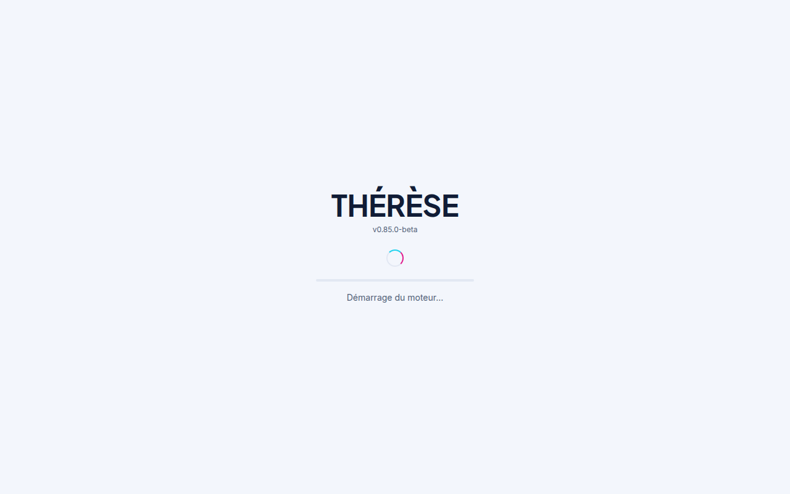
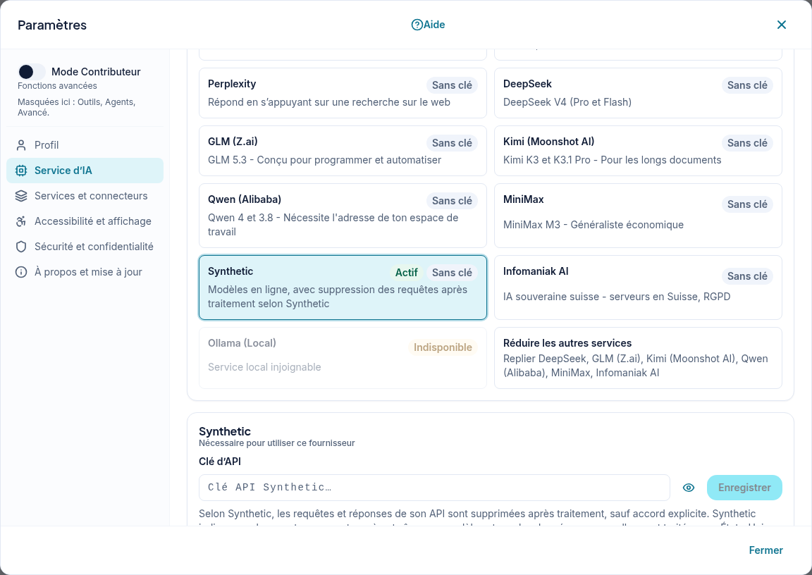
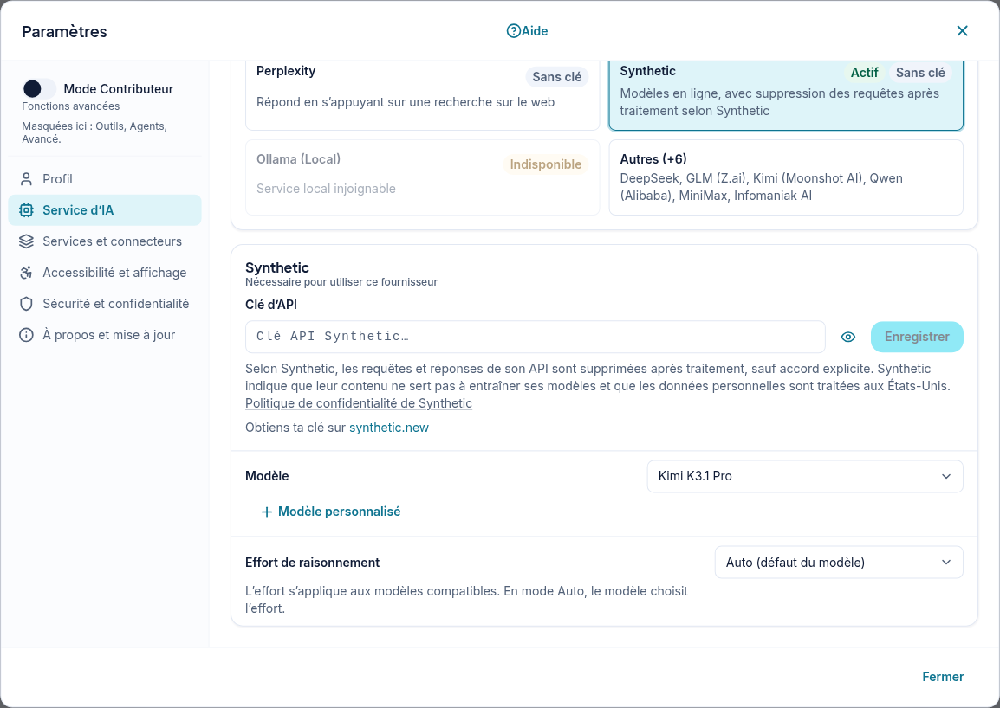
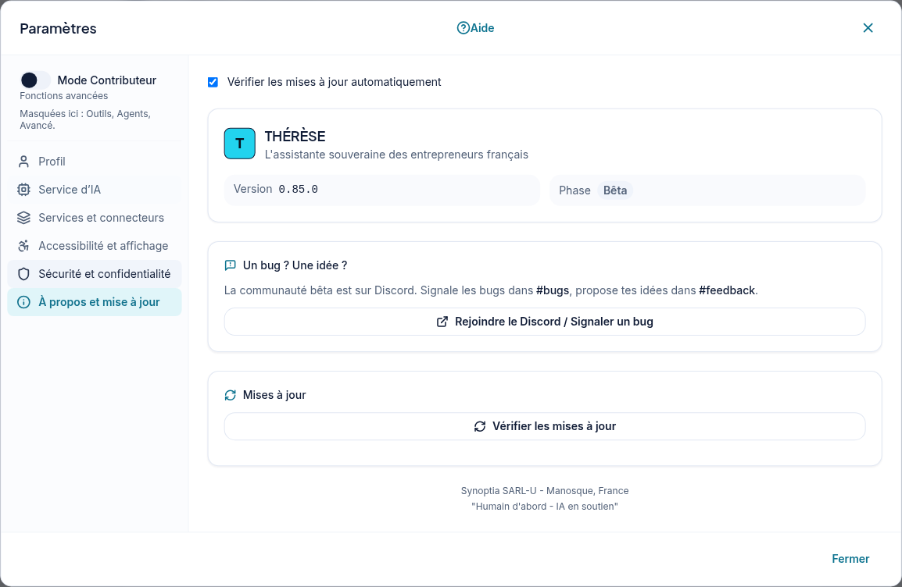

# Guide des testeurs de THÉRÈSE 0.85

> **Édition bêta 0.85.0**, novembre 2026.
> **Éditeur** : Synoptïa (Ludovic Sanchez)
> **Contact** : ludo@synoptia.fr

---

## Bienvenue dans la bêta

**THÉRÈSE** est un assistant IA souverain conçu pour les solopreneurs et TPE français. Son ambition : te donner un copilote intelligent qui comprend ton métier, retient tes contacts et projets, et t'accompagne au quotidien - le tout en gardant tes données chez toi.

**"Ta mémoire, tes données, ton business."**

### Ce que tu testes

Cette bêta te permet d’essayer les fonctionnalités en cours de finition et de signaler les problèmes rencontrés.

---

## Combien ça coûte ?

**THÉRÈSE est 100% gratuite**, open source, et le restera.

En revanche, le **service d'intelligence artificielle** qui fait tourner les réponses (Anthropic, OpenAI, Google, Mistral...) est payant à l'usage. Le montant dépend du modèle et de la quantité de texte traitée. Dans **Paramètres > Service d’IA**, le mode standard affiche le coût estimé du mois en dollars. Ouvre **Voir le détail de la consommation** pour lire l’usage du jour et du mois. Pour régler les limites et le budget, active le **Mode Contributeur** puis ouvre **Avancé > Limites & Consommation**.

Si tu veux un usage **100% gratuit et sans connexion internet**, tu peux utiliser **Ollama** : un logiciel qui fait tourner l'IA directement sur ton ordinateur, sans rien envoyer à l'extérieur. La qualité des réponses dépend alors de la puissance de ta machine.

### Comment remonter un problème

Tu as trois options (la première est recommandée) :

1. **Discord** (recommandé) : rejoins le serveur des testeurs via [discord.gg/krDGArdbH8](https://discord.gg/krDGArdbH8), puis mentionne `@Thérèse bug : [description du problème]` dans le salon **#bugs**. Le bot crée automatiquement un thread dédié et te demande des précisions. Pour les retours plus généraux (idées, impressions, ergonomie), utilise le salon **#feedback**.
2. **GitHub Issues** : ouvre une [issue](https://github.com/ludovicsanchez38-creator/Synoptia-THERESE/issues/new?template=bug_report.md) avec le template de bug report
3. **Email** : envoie un message à **ludo@synoptia.fr** avec le sujet `[THÉRÈSE Bêta] Bug`

### Le cycle de correction

1. Tu signales un bug sur Discord
2. **Thérèse** (bot Discord) crée un thread et prépare une fiche
3. Chaque nuit à 2h, **Zézette** (bot développeuse) lit les fiches, code les corrections, et push sur GitHub
4. Le matin, une nouvelle build est disponible dans **#changelog**
5. Tu peux vérifier que le bug est corrigé

---

## Installation et premier lancement

### Installation simple (recommandée)

1. Ouvre la [page de téléchargement bêta](https://synoptia.fr/therese/beta/) et choisis le fichier de ton système.
   - **macOS** · fichier `.dmg`
   - **Windows** · fichier `.exe`
   - **Linux (Debian et Ubuntu)** · fichier `.deb`
2. Ouvre l’installeur. Au démarrage de la 0.85.0, l’application affiche `v0.85.0-beta`.



> **macOS**. L’application attend encore sa signature Apple. Après un premier essai d’ouverture, si Gatekeeper bloque l’application téléchargée depuis la page bêta officielle, ouvre **Réglages Système > Confidentialité et sécurité**. Utilise **Ouvrir quand même** pour THÉRÈSE, puis confirme l’ouverture. [Marche à suivre officielle d’Apple](https://support.apple.com/fr-fr/102445)

> **Windows** : si SmartScreen affiche un avertissement, clique sur **"Plus d'infos"** puis **"Exécuter quand même"**.

### Installation depuis les sources (développeurs)

Si tu souhaites compiler le projet toi-même, consulte le guide technique : [guide de démarrage technique](https://github.com/ludovicsanchez38-creator/Synoptia-THERESE/blob/main/docs/GETTING_STARTED.md).

### Configuration initiale

Au premier lancement, un **assistant de configuration** te guide en 6 étapes :

1. **Bienvenue**. Découvre un premier exemple, comme préparer une relance pour un devis.
2. **Profil**. Renseigne ton nom, ton entreprise et ton rôle. Le choix **Importer un profil existant** donne accès à l’import d’un fichier `THÉRÈSE.md`.
3. **Service d’IA**. Si un service est déjà configuré, son nom et le modèle choisi apparaissent avant la procédure, que tu peux déplier. Sinon, choisis parmi quinze services, dont Synthetic. Ollama peut arriver en tête si le service Ollama répond. Pour un service en ligne, renseigne ton code d’accès (clé API).
4. **Confidentialité**. Lis les informations sur les connexions et les risques. Avec Claude, un exemple détaille le premier « Bonjour » envoyé avec un profil vierge.
5. **Dossier de travail**. Choisis un dossier dédié pour tes fichiers ou clique sur **Continuer sans dossier** pour poursuivre. Si THÉRÈSE y rencontre un refus de création de lien physique, elle te prévient que les PDF de devis et de factures peuvent échouer. Choisis alors un dossier dédié sur le disque interne, par exemple dans **Documents**. Tu peux changer ce choix dans **Paramètres > Avancé > Stockage des données**. Active le **Mode Contributeur** dans Paramètres si la rubrique Avancé est masquée.
6. **Terminé** - Résumé de ta configuration

---

## Fonctionnalités testables

### 1. Chat IA (multi-service IA)

Le cœur de THÉRÈSE : une conversation fluide avec un LLM de ton choix.

**Exemples de services et de modèles proposés**

| Service IA (provider) | Modèles | Code d'accès (clé API) requis |
|----------|---------|-----------------|
| **Anthropic** | Claude Opus 5.5, Sonnet 5.5, Haiku 5.5 | `sk-ant-...` |
| **OpenAI** | GPT-6.2 Sol par défaut, GPT-6.2 Astra pour les tâches complexes, GPT-6 Sol | `sk-...` |
| **Gemini** | Gemini 3.8 Flash par défaut, Gemini 4 Hydrogen, Neon et Carbon | `AIza...` |
| **Mistral** | Mistral Large 4.0 par défaut | Code Mistral |
| **Grok** | Grok 4.7 par défaut | `xai-...` |
| **Ollama** | Modèles locaux installés | Aucun pour les modèles locaux |
| **Synthetic** | Grand modèle texte (`syn:large:text`), Kimi K3.1 Pro (`hf:moonshotai/Kimi-K3.1-Pro`) | Code d’accès Synthetic |

Si tu avais enregistré GPT-6 Sol, le chat conserve ce choix. Avec GPT-6.2 Sol ou Astra, le réglage **Auto** laisse le modèle choisir l’effort de raisonnement.

Pour utiliser Claude, choisis **Anthropic**, copie le code d’accès de ton compte Anthropic et renseigne-le dans la mise en route ou dans **Paramètres > Service d’IA**. Tu peux ensuite vérifier la clé et choisir Claude Opus 5.5 ou un autre modèle Claude.

#### Configurer Synthetic

Dans la mise en route, sélectionne **Synthetic** parmi les services d’IA. Si THÉRÈSE est déjà configurée, ouvre **Paramètres > Service d’IA > Autres**, puis sélectionne **Synthetic**. Renseigne ton code d’accès. La présence de la clé dans le coffre et sa validation par le service sont deux états distincts. L’accord de transfert s’applique au service et à l’usage indiqués à l’écran.

Selon Synthetic, les requêtes et réponses de son API sont supprimées après traitement, sauf accord explicite. Synthetic indique que leur contenu ne sert pas à entraîner ses modèles et que les données personnelles sont traitées aux États-Unis. [Politique de confidentialité de Synthetic](https://synthetic.new/policies/privacy)





**Ce que tu peux tester** :
- Envoyer des messages et observer l'**affichage progressif** (réponse mot par mot)
- Changer de provider/modèle dans **Paramètres** (icône engrenage)
- Les **commandes slash** : tape `/` dans le champ de saisie pour voir la liste
  - `/contact` - Mentionner ou créer un contact
  - `/projet` - Mentionner ou créer un projet
  - `/recherche` - Chercher dans la mémoire
  - `/fichier [chemin]` - Inclure le contenu d'un fichier dans le contexte
  - `/résumé` - Résumer la conversation en cours
  - `/tâches` - Extraire les tâches de la conversation
  - `/email` - Rédiger un email
  - `/rdv` - Préparer un rendez-vous

---

### 2. Mémoire (contacts et projets)

THÉRÈSE retient tes contacts, tes projets et les informations importantes.

**Ce que tu peux tester** :
- **Ajouter un contact** : ouvre l'espace de travail (`Cmd+M` sur macOS / `Ctrl+M` sur Windows), onglet Contacts, bouton "+"
- **Ajouter un projet** : onglet Projets, bouton "+"
- **Extraction automatique d'entités** : parle d'une personne ou d'un projet dans le chat, THÉRÈSE détecte les entités et te propose de les sauvegarder (bandeau sous le message)
- **Injection automatique du contexte** : quand tu poses une question sur un contact ou un projet connu, THÉRÈSE injecte les informations pertinentes dans sa réponse
- **Recherche intelligente** : la recherche combine recherche par sens (comprend le contexte, pas seulement les mots exacts) et recherche par mots-clés
- **Périmètre**. Dans **Contacts**, les filtres **Tout**, **Global**, **Projet** et **Conversation** expliquent dans quelles conversations tu peux retrouver une fiche. Ouvre **Comprendre les périmètres** pour relire les règles.

---

### 3. Skills Office (génération de documents)

THÉRÈSE génère des fichiers Office professionnels directement depuis le chat.

**Formats disponibles** :

| Skill | Format | Description |
|-------|--------|-------------|
| **Document Word** | `.docx` | Rapports, guides, procédures - style Synoptïa |
| **Présentation PPT** | `.pptx` | Slides 16:9 avec dark theme |
| **Tableur Excel** | `.xlsx` | Tableaux avec formules, multi-onglets |

**Comment tester** :
1. Sur l'écran d'accueil, clique sur **Produire**
2. Choisis **Document Word**, **Présentation PPT** ou **Tableur Excel**
3. Décris ce que tu veux dans le prompt (ex: "Crée une présentation de 10 slides sur les tendances IA 2026")
4. Si la carte **Confirmer la création du document** apparaît, vérifie le format et le contenu puis confirme. Dans l’application installée, **Télécharger** ouvre la boîte de dialogue d’enregistrement du fichier généré.

**Note technique** : les modèles puissants (Claude, GPT) utilisent la génération par code Python (meilleure qualité). Les modèles plus légers (Ollama, Gemini Flash) utilisent un pipeline Markdown avec conversion automatique.

---

### 4. Guided Prompts (écran d'accueil)

L'écran d'accueil propose 4 catégories d'actions guidées avec des prompts pré-remplis.

| Catégorie | Icône | Options |
|-----------|-------|---------|
| **Produire** | Sparkles | Email pro, Post LinkedIn, Proposition commerciale, Document Word, Présentation PPT, Tableur Excel, Image IA GPT, Image IA Gemini |
| **Comprendre** | Brain | Fichier Excel, Document PDF, Site web, Marché, Outil IA, Concept, Best practices |
| **Organiser** | GitBranch | Réunion, Projet, Semaine, Objectifs, Workflow |
| **Personnaliser** | Plus | Créer une commande, Créer une skill, Créer une automatisation |

Clique sur une catégorie, puis choisis une sous-option. Le prompt se pré-remplit dans le champ de saisie - tu n'as plus qu'à compléter les `[placeholders]` et envoyer.

---

### 5. Board de Décision (Cmd+D / Ctrl+D)

Pour tes décisions stratégiques, convoque un **board de 5 conseillers IA**. Chaque conseiller a une personnalité et un angle d'analyse distincts :

| Conseiller | Rôle | Provider préféré |
|------------|------|-----------------|
| L'Analyste | Données, chiffres, ROI, métriques | Anthropic (Claude) |
| Le Stratège | Vision long terme, positionnement | OpenAI (GPT) |
| L’Avocat du Diable | Contre-arguments, risques | xAI (Grok) |
| Le Pragmatique | Faisabilité, actions concrètes | Mistral |
| Le Visionnaire | Innovation, tendances futures | Gemini |

**Comment tester** :
1. Appuie sur `Cmd+D` sur macOS / `Ctrl+D` sur Windows (ou utilise la palette de commandes)
2. Pose ta question stratégique (ex: "Dois-je lancer une formation en ligne à 490 euros ?")
3. Ajoute un contexte optionnel
4. Lance la délibération
5. Observe chaque conseiller répondre progressivement
6. Lis la **synthèse** avec les points de consensus, divergences et recommandation finale

Le Board cloud vérifie les cinq services avant de lancer la délibération. En cas de service indisponible, le message nomme le fournisseur dont la configuration doit être vérifiée.

L'historique des décisions est sauvegardé et consultable.

---

### 6. Calculateurs financiers et décisionnels

Accessibles via l'API, ces calculateurs aident à la prise de décision chiffrée :

| Calculateur | Formule | Usage |
|-------------|---------|-------|
| **ROI** | (Gain - Investissement) / Investissement x 100 | Évaluer le rendement d'un investissement |
| **ICE** | Impact x Confidence x Ease | Prioriser des idées/tâches (score 1-10 par critère) |
| **RICE** | (Reach x Impact x Confidence%) / Effort | Prioriser des fonctionnalités produit |
| **NPV** | -Investissement + somme(CF / (1+r)^t) | Valeur actuelle nette d'un projet |
| **Break-even** | Coûts fixes / (Prix - Coût variable) | Seuil de rentabilité en unités |

Chaque calculateur retourne le résultat chiffré et une **interprétation en français**.

---

### 7. Recherche Web

THÉRÈSE peut chercher des informations actuelles sur le web pour répondre à tes questions.

**Comportement selon le provider** :
- **Gemini** : utilise le Google Search Grounding nativement
- **Autres providers** (Claude, GPT, Mistral, Grok) : utilisent un tool DuckDuckGo (gratuit, sans clé API)

**Activation**. Ouvre **Paramètres > Services et connecteurs > Recherche Web**.

**Ce que tu peux tester** : pose une question d'actualité (ex: "Quelles sont les dernières annonces d'Apple ?") et observe THÉRÈSE chercher sur le web avant de répondre.

---

### 8. Transcription vocale (dictée)

Dicte tes messages au lieu de les taper. THÉRÈSE utilise **Groq Whisper** (modèle whisper-large-v3-turbo) pour transcrire l'audio en texte français.

**Configuration requise** :
- Code d'accès Groq (clé API, gratuite sur [console.groq.com](https://console.groq.com))
- Configure le code dans **Paramètres > Services et connecteurs > Transcription vocale**. Il commence par `gsk_`.

**Comment tester** :
1. Clique sur le bouton **micro** à droite du champ de saisie
2. Parle (le bouton pulse en rouge pendant l'enregistrement)
3. Clique à nouveau pour arrêter
4. Le texte transcrit apparaît dans le champ de saisie

La dictée fonctionne dans l'**application desktop** comme en mode web (`http://localhost:1420` dans un navigateur). Au premier enregistrement, autorise l'accès au micro quand le système te le demande.

---

### 9. Génération d'images

THÉRÈSE génère des images via deux providers :

| Provider | Modèle | Résolutions | Clé API |
|----------|--------|-------------|---------|
| **GPT Image 1.5** | gpt-image-1.5 | 1024x1024, 1536x1024, 1024x1536 | Clé OpenAI (séparée de celle du LLM) |
| **Nano Banana Pro** | gemini-3-pro-image-preview | 1K, 2K, 4K | Clé Gemini (séparée de celle du LLM) |

**Comment tester** :
1. Écran d'accueil -> **Produire** -> **Image IA (GPT)** ou **Image IA (Gemini)**
2. Décris l'image souhaitée
3. Télécharge le résultat

**Configuration**. Ouvre **Paramètres > Services et connecteurs > Génération d’images**. Les codes d’accès des images sont distincts de ceux du chat.

---

### 10. Connexions externes (MCP)

Les **connexions externes** (protocole MCP) permettent à THÉRÈSE de se connecter à des services tiers. L'IA peut utiliser ces services automatiquement pendant la conversation.

**18 presets disponibles** organisés en 8 catégories :

| Catégorie | Presets |
|-----------|---------|
| **Essentiels** | Filesystem, Fetch, Time |
| **Productivité** | Google Workspace, Notion, Airtable, Todoist, Trello |
| **Recherche** | Brave Search, Perplexity |
| **Marketing** | Brevo |
| **CRM & Ventes** | HubSpot CRM, Pipedrive |
| **Finance** | Stripe |
| **Communication** | WhatsApp Business |
| **Avancé** | Sequential Thinking, Slack, Playwright |

**Comment tester** :
1. Ouvre **Paramètres**, active le **Mode Contributeur**, puis choisis **Outils > Presets**.
2. Installe un service (ex: Filesystem pour la gestion de fichiers, aucun code d'accès requis)
3. Démarre la connexion
4. Dans le chat, l'IA peut maintenant utiliser ces services automatiquement

**Sécurité** : les codes d'accès (clés API) des connexions externes sont protégés par un chiffrement avancé et stockés localement sur ta machine. Sur macOS, la protection est renforcée par le trousseau de sécurité macOS (Keychain).

---

### 11. CRM Sync (synchronisation Google Sheets)

THÉRÈSE peut synchroniser tes données CRM depuis un Google Sheets.

**Ce qui est synchronisé** :
- **Clients** : ID, Nom, Entreprise, Email, Téléphone, Source, Stage, Score, Tags
- **Projets** : ID, Client lié, Nom, Description, Statut, Budget
- **Livrables** : ID, Projet lié, Titre, Description, Statut, Date d'échéance

**Configuration**. Active le **Mode Contributeur** dans Paramètres. Ouvre **Avancé > Synchronisation CRM**, puis renseigne l’identifiant du tableur.

---

### 12. Espace de travail

Ouvre les modules depuis **Espace de travail**. Utilise **Retour** pour retrouver l’écran depuis lequel tu les as ouverts.

| Panneau | Raccourci macOS | Raccourci Windows | Description |
|---------|----------------|-------------------|-------------|
| **Email** | `Cmd+E` | `Ctrl+E` | Intégration Gmail |
| **Calendrier** | `Cmd+Shift+C` | `Ctrl+Shift+C` | Google Calendar |
| **Tâches** | `Cmd+T` | `Ctrl+T` | Kanban de tâches |
| **Factures** | `Cmd+I` | `Ctrl+I` | Gestion de factures |
| **CRM Pipeline** | `Cmd+P` | `Ctrl+P` | Vue pipeline CRM |

Les données de ces modules sont sauvegardées sur cet ordinateur.

**Générer un devis en PDF**. Ouvre **Devis et factures**, enregistre ton
brouillon, puis repère le bouton **PDF** sur sa ligne. Les mentions manquantes
s’affichent près du bouton. Complète celles de l’émetteur dans
**Paramètres > Profil** et celles du destinataire dans le brouillon.

---

### 13. Vue Accueil (ta journée en un coup d'oeil)

À l'ouverture, THÉRÈSE affiche un tableau de bord qui rassemble l'essentiel de ta journée :

- **Checklist de mise en route** : tant que tout n'est pas branché, une carte te rappelle les étapes restantes (configurer une clé IA ou Ollama, connecter ton agenda, connecter ta messagerie, compléter le profil de facturation). Chaque étape est cliquable et t'amène au bon endroit. La carte disparaît une fois tout configuré.
- **Actions rapides** : nouvelle conversation, produire un document, ajouter un contact, factures.
- **Conversations récentes** : reprends une discussion là où tu l'avais laissée.
- **Agenda du jour** : tes rendez-vous de la journée, avec un raccourci vers le calendrier.
- **À traiter** : factures en retard à relancer, prospects sans nouvelles et tâches urgentes. Chaque ligne ouvre directement la vue concernée.

**Comment tester** : ouvre la palette de commandes (`Cmd+K` / `Ctrl+K`) et choisis **Accueil**. Vérifie que tes rendez-vous du jour et tes tâches urgentes remontent bien.

---

### 14. Vue Projets (kanban)

Tes projets s'affichent en plein écran, en colonnes par statut (kanban).

- Visualise l'avancement de tous tes projets d'un coup d'oeil
- Clique sur une carte pour consulter ou modifier le projet
- Ce sont les mêmes projets que dans la Mémoire (onglet Projets) : juste une autre vue sur les mêmes données

**Comment tester** : palette de commandes (`Cmd+K` / `Ctrl+K`) -> **Ouvrir les Projets**.

---

### 15. L'Atelier (agents IA embarqués)

L'Atelier est un panneau coulissant où tu délègues des tâches à des agents IA, sans quitter THÉRÈSE.

- **Chat avec Katia** : décris ta tâche en langage naturel (recherche, rédaction, analyse...), Katia la traite et te répond dans un fil dédié. Tu vois quand elle réfléchit et tu peux relancer la conversation.
- **Catalogue d'agents métier** : Chercheur Web, Rédacteur, Analyste, Planificateur, Codeur, Créatif. Chacun est préconfiguré pour un type de mission.
- **Missions et revue de code** : pour les profils techniques, l'Atelier propose aussi un suivi de mission étape par étape et un panneau de revue de code.

**Comment tester** :
1. Appuie sur `Cmd+Shift+A` / `Ctrl+Shift+A` pour ouvrir l'Atelier (ou `Cmd+Shift+K` pour lancer directement une tâche avec Katia)
2. Décris une mission concrète (ex: "Prépare un plan de relance pour mes factures impayées")
3. Observe l'agent travailler et réponds-lui si besoin

---

### 16. Mises à jour automatiques

THÉRÈSE vérifie discrètement si une nouvelle version est disponible (au lancement, puis toutes les 6 heures). Quand c'est le cas, un **bandeau** apparaît en haut de l'application :

1. Le bandeau t'annonce la nouvelle version
2. Clique pour lancer le **téléchargement en arrière-plan** (la progression s'affiche)
3. Quand c'est prêt, clique sur **Redémarrer** pour appliquer la mise à jour

Tu peux aussi ouvrir **Paramètres > À propos et mise à jour**, puis choisir **Vérifier les mises à jour**. L’écran affiche le numéro **0.85.0** et la phase **Bêta** séparément. Le suffixe de bêta seul ne change pas le numéro du moteur. Un numéro supérieur est proposé en mise à jour. Si le redémarrage automatique échoue, redémarre THÉRÈSE manuellement. Pour une installation manuelle, ouvre la [page de téléchargement bêta](https://synoptia.fr/therese/beta/).



---

## Raccourcis clavier

### Chat

| Raccourci macOS | Raccourci Windows | Action |
|----------------|-------------------|--------|
| `Entrée` | `Entrée` | Envoyer le message |
| `Shift+Entrée` | `Shift+Entrée` | Nouvelle ligne |
| `Cmd+N` | `Ctrl+N` | Nouvelle conversation |
| `Cmd+Suppr` | `Ctrl+Suppr` | Effacer la conversation |

### Navigation

| Raccourci macOS | Raccourci Windows | Action |
|----------------|-------------------|--------|
| `Cmd+K` | `Ctrl+K` | Palette de commandes |
| `Cmd+/` | `Ctrl+/` | Afficher les raccourcis clavier |
| `Cmd+B` | `Ctrl+B` | Sidebar conversations |
| `Cmd+M` | `Ctrl+M` | Espace de travail (mémoire) |
| `Échap` | `Échap` | Fermer le panneau actif |

### Fonctionnalités

| Raccourci macOS | Raccourci Windows | Action |
|----------------|-------------------|--------|
| `Cmd+D` | `Ctrl+D` | Board de décision |
| `Cmd+E` | `Ctrl+E` | Email (Gmail) |
| `Cmd+T` | `Ctrl+T` | Tâches (Kanban) |
| `Cmd+I` | `Ctrl+I` | Factures |
| `Cmd+P` | `Ctrl+P` | CRM Pipeline |

### Outils

| Raccourci macOS | Raccourci Windows | Action |
|----------------|-------------------|--------|
| `Cmd+Shift+C` | `Ctrl+Shift+C` | Calendrier (Google Calendar) |
| `Cmd+Shift+P` | `Ctrl+Shift+P` | Nouveau projet |
| `Cmd+Shift+F` | `Ctrl+Shift+F` | Rechercher en mémoire |

### Fichiers

| Raccourci macOS | Raccourci Windows | Action |
|----------------|-------------------|--------|
| `Cmd+O` | `Ctrl+O` | Ouvrir un fichier |
| `Cmd+Shift+O` | `Ctrl+Shift+O` | Ouvrir un dossier |
| `Cmd+S` | `Ctrl+S` | Sauvegarder |

---

## Limitations connues de la bêta

### Application desktop

- **Base chiffrée depuis la 0.23 - ne PAS revenir en arrière** : au premier lancement
  d'une version >= 0.23, ta base de données est chiffrée (SQLCipher). Une version
  antérieure de THÉRÈSE ne peut plus la lire (erreur « file is not a database ») :
  ne réinstalle pas une version plus ancienne après ce premier lancement. Tes
  sauvegardes (**Paramètres > Avancé > Stockage des données** en mode Contributeur) contiennent tout ce qu'il faut pour restaurer,
  y compris la clé de chiffrement - protège ces fichiers comme la base elle-même.
- **Signature macOS**. L’application attend encore sa signature Apple. Suis la procédure de la section Installation pour autoriser l’ouverture du téléchargement officiel.
- **Pas de notifications push** : les notifications ne sont pas encore implémentées.
- **La compilation nécessite Xcode CLI tools (macOS)** : installe-les avec `xcode-select --install` avant de compiler. Sur Windows, il faut Visual Studio Build Tools.

### Fonctionnalités

- **Pièces jointes aux e-mails** · Pour tes envois avec une pièce jointe, utilise ta messagerie. La commande **Joindre** est masquée dans le composeur de THÉRÈSE pendant la bêta.
- **Email Gmail - deux approches** :
  1. **Simple (recommandée)** : « SMTP / IMAP classique » dans l'assistant email, preset
     Gmail, avec un **mot de passe d'application** Google (myaccount.google.com/apppasswords,
     validation en 2 étapes requise sur le compte). Prêt en 2 minutes, aucun projet
     Google Cloud à créer. Le mot de passe est chiffré localement.
  2. **Avancée (OAuth)** : accès API Gmail complet, mais demande de créer ses propres
     identifiants OAuth dans Google Cloud Console. À réserver aux utilisateurs à
     l'aise avec la console Google. Points qui piègent (merci lcjp) :
     - Type de client : choisir « **Application Web** » (pas « Application de
       bureau ») - c'est le seul type qui offre le champ « URI de redirection
       autorisés » où coller l'URL que THÉRÈSE affiche en cas d'erreur 403.
     - **Activer les deux APIs** dans « APIs et services > Bibliothèque » :
       « Gmail API » **et** « Google Calendar API ». Sans la seconde, la
       connexion Gmail fonctionne mais le calendrier renvoie « accès refusé ».
     - Écran de consentement : ajouter ton adresse Gmail comme utilisateur test.
- **Panneau Calendrier Google** : nécessite la configuration OAuth (approche 2),
  avec l'API « Google Calendar » activée dans le même projet. Le calendrier
  local et CalDAV fonctionnent sans.
- **Ollama** : nécessite qu'Ollama soit installé et lancé localement (`ollama serve`).
- **Connexions externes (MCP)** : certains services nécessitent des packages npm globaux. En cas d'erreur au démarrage, vérifie que `npx` est dans ton PATH.

### Performance

- **Première recherche intelligente** : le chargement initial du moteur de recherche prend quelques secondes.
- **Gros fichiers** : l'indexation de fichiers volumineux peut prendre du temps (chunking par blocs de 1000 caractères).

---

## Comment remonter un bug

Pour nous aider à corriger rapidement, réponds simplement à ces 3 questions :

### 1. Que faisais-tu ?

Décris ce que tu étais en train de faire, étape par étape. Par exemple :
> 1. J'ai ouvert l'application
> 2. J'ai tapé "Crée un document Word sur le marketing digital"
> 3. J'ai cliqué sur Envoyer

### 2. Que s'est-il passé ?

Décris ce qui s'est passé (au lieu de ce que tu attendais). Par exemple :
> Le cercle de chargement tourne sans fin, aucun fichier n'apparaît.

### 3. Capture d'écran

Si possible, fais une capture d'écran de l'erreur (sur Mac : `Cmd+Shift+4`, sur Windows : `Win+Shift+S`).

> **Note pour les développeurs** : les informations techniques (service IA utilisé, version OS, mode d'exécution, logs) sont les bienvenues si tu sais les récupérer, mais elles ne sont pas indispensables pour signaler un bug.

### Modèle simplifié de rapport de bug

```
## Bug : [titre court]

**Que faisais-tu ?**
1. ...
2. ...
3. ...

**Que s'est-il passé ?**
...

**Capture d'écran** :
[joindre si possible]
```

<details>
<summary>Modèle détaillé (pour les profils techniques)</summary>

```
## Bug : [titre court]

**Étapes** :
1. ...
2. ...
3. ...

**Attendu** : ...
**Observé** : ...

**Service IA (provider)** : [provider] / [modèle]
**OS** : [ex: macOS 15.3 ou Windows 11 24H2]
**Mode** : Application desktop / Navigateur web

**Logs** :
[copier-coller les erreurs ici]

**Capture** :
[joindre si possible]
```

</details>

---

## FAQ rapide

**Q : Où sont stockées mes données ?**
R : Tout est local dans `~/.therese/` (base SQLite, embeddings Qdrant, images générées, backups).

**Q : Mes conversations sont-elles envoyées quelque part ?**
R : Uniquement au service IA (provider) que tu as choisi (Anthropic, OpenAI, etc.) pour obtenir les réponses. Avec un modèle local (Ollama), le contenu de tes conversations ne part chez aucun fournisseur de modèle ; la recherche web, la messagerie, l'agenda et les modèles Ollama Cloud passent toujours par leurs services.

**Q : Comment changer de service IA ?**
R · Dans **Paramètres > Service d’IA**, sélectionne un autre service et renseigne ton code d’accès (clé API).

**Q : Comment exporter mes données ?**
Dans **Paramètres > Sécurité et confidentialité**, choisis **Exporter toutes mes données** pour l’export RGPD. Pour une conversation seule, ouvre son menu dans le tiroir des conversations et utilise **Exporter**.

**Q : Le board de décision utilise plusieurs LLMs en même temps ?**
Oui. En mode cloud, chaque conseiller utilise le fournisseur indiqué dans le Board. Les cinq services doivent être disponibles pour lancer la délibération.

**Q : Comment mettre à jour THÉRÈSE ?**
R · Lance la vérification dans **Paramètres > À propos et mise à jour** ou suis le bandeau de mise à jour. L’installeur reste disponible sur la [page de téléchargement bêta](https://synoptia.fr/therese/beta/).

**Q : THÉRÈSE fonctionne sur Windows ?**
R · Télécharge le `.exe` depuis la [page de téléchargement bêta](https://synoptia.fr/therese/beta/). Les raccourcis utilisent `Ctrl` au lieu de `Cmd`.

**Q : J'ai une idée d'amélioration, où la proposer ?**
R : Partage ton idée sur le salon **#feedback** sur Discord, ou envoie un email à ludo@synoptia.fr.

---

Merci de participer à la bêta de THÉRÈSE.

**Synoptïa** - "Humain d'abord, IA en soutien."
